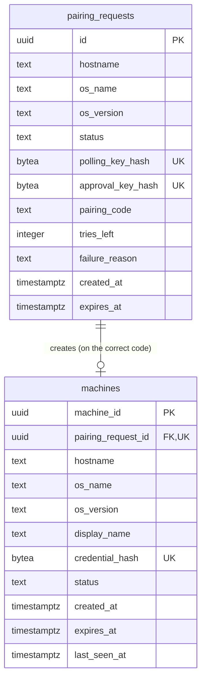
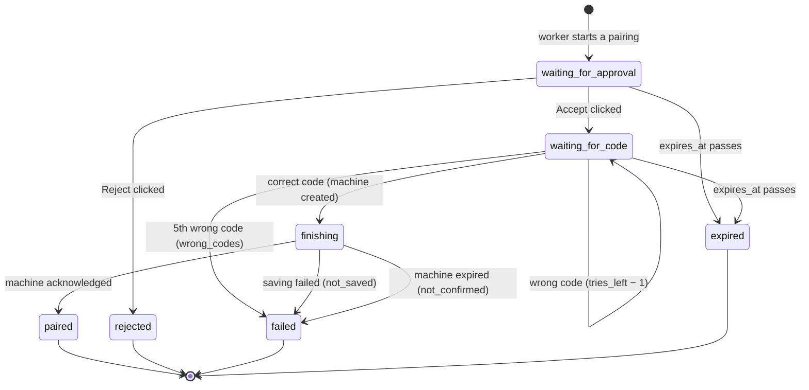
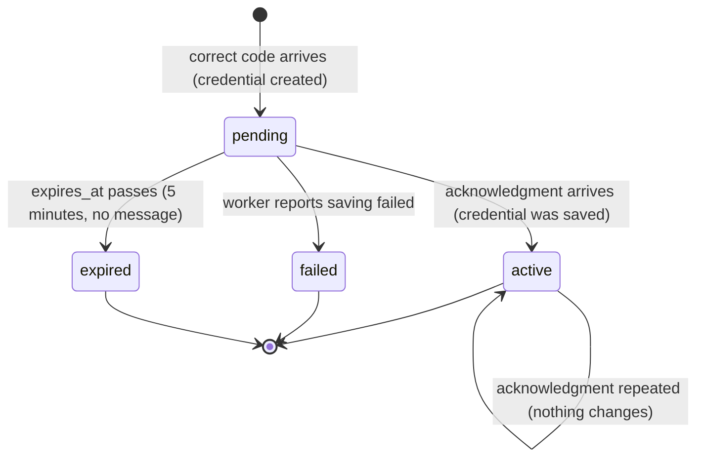

# Data model

Everything tervi stores: the server's database tables and the worker's local
data. This file lives across slices; each slice's plan pull request updates
it. The HTTP contract is in [`api/openapi.yaml`](../api/openapi.yaml).

**Source of truth.** For the database, the migration files in
`internal/server/db/migrations/` are the truth; this file explains them and
must agree with them. For the worker's local data, this file is the truth.

## Server database



A pairing request creates at most one machine. A machine always belongs to
exactly one pairing request.

### `pairing_requests`

One row per pairing attempt. Added by slice 0001 (migration `0001`).

| Column | Type | Rules | Meaning |
| --- | --- | --- | --- |
| `id` | `uuid` | primary key, generated | The pairing request's ID |
| `hostname` | `text` | not null, default `''` | As reported by the worker; may be empty; at most 64 characters (checked by the API) |
| `os_name` | `text` | not null, default `''` | As reported by the worker; may be empty; at most 64 characters |
| `os_version` | `text` | not null, default `''` | As reported by the worker; may be empty; at most 32 characters |
| `status` | `text` | not null, one of the lifecycle states below | Where the attempt is |
| `polling_key_hash` | `bytea` | not null, unique | SHA-256 of the polling key; the key itself is never stored |
| `approval_key_hash` | `bytea` | not null, unique | SHA-256 of the approval key; the key itself is never stored |
| `pairing_code` | `text` | null until Accept | The 8-digit code, stored as shown, for example `1234-5678`, so the page can show it again |
| `tries_left` | `integer` | not null, default `5` | Wrong codes still allowed |
| `failure_reason` | `text` | null, or `wrong_codes`, `not_saved`, `not_confirmed` | Set whenever the status becomes `failed` |
| `created_at` | `timestamptz` | not null, default `now()` | When the worker started |
| `expires_at` | `timestamptz` | not null | 10 minutes after creation; covers only the human steps |

#### Lifecycle

Boxes are the values of `status`. A state with no arrow out is final.



**Expiry is applied when read.** A row past `expires_at` may still say
`waiting_for_…` in the table; every query reads it as `expired` (and a
`finishing` row whose machine expired as `failed`). A clean-up job runs every
minute and writes those states into the table.

### `machines`

One row per paired computer. Added by slice 0001 (migration `0001`). Created
when the correct code arrives; it holds the credential's hash, which the
pairing request never does.

| Column | Type | Rules | Meaning |
| --- | --- | --- | --- |
| `machine_id` | `uuid` | primary key, generated | The machine's permanent ID |
| `pairing_request_id` | `uuid` | not null, unique, references `pairing_requests(id)` | The pairing that created this machine |
| `hostname` | `text` | not null, default `''` | Copied from the pairing request |
| `os_name` | `text` | not null, default `''` | Copied from the pairing request |
| `os_version` | `text` | not null, default `''` | Copied from the pairing request |
| `display_name` | `text` | not null | Starts as the hostname, or `unknown` when that is empty |
| `credential_hash` | `bytea` | not null, unique | SHA-256 of the credential; the credential itself is never stored |
| `status` | `text` | not null, one of the lifecycle states below | Where the machine is |
| `created_at` | `timestamptz` | not null, default `now()` | When the correct code arrived |
| `expires_at` | `timestamptz` | not null | 5 minutes after creation; matters only while `pending` |
| `last_seen_at` | `timestamptz` | null until the first connection | When the server last heard from the machine over its connection. Added by slice 0002 (migration `0002`). |

**`last_seen_at`** is set when the machine connects, at least once a minute
while it stays connected, and when the connection ends (the time of the last
message received). If the server stops suddenly, it may be up to one minute
early. Whether a machine is Online is not stored: it is true exactly while
the server holds the machine's connection in memory.

#### Lifecycle



Each machine change also moves its pairing request out of `finishing`:
acknowledged → `paired`; saving failed → `failed` (`not_saved`); expired →
`failed` (`not_confirmed`). Both change in one transaction.

Only `active` machines exist for the user. A `pending`, `failed`, or
`expired` machine appears nowhere the user can see, and its credential is
accepted for nothing except acknowledging or reporting a failure while
`pending`.

## Worker local data

The worker keeps four things on the paired computer: the secret store
entry, `state.json`, the systemd service file, and the runtime folder.
Later worker versions
must still read the first two, so changing their format needs a migration
plan of its own.

### Secret store entry

One entry in the OS secret store (GNOME Keyring on Linux), service `tervi`,
user `worker`. Its value is JSON:

```json
{ "server": "http://localhost:8080", "credential": "<credential>" }
```

| Field | Meaning |
| --- | --- |
| `server` | The server that issued the credential, in standard form. **The only place the worker reads the server address from before sending the credential.** |
| `credential` | The machine credential. Secret. |

### `state.json`

`~/.config/tervi/state.json` (the user's configuration folder). Holds nothing
secret and no server address, so editing it cannot redirect the credential.

```json
{
  "machine_id": "…",
  "credential_saved": true,
  "confirmed": true,
  "connect": true,
  "stop_reason": null
}
```

| Field | Meaning |
| --- | --- |
| `machine_id` | The machine this computer became |
| `credential_saved` | `false` from just before the secret store entry is saved; `true` once it was saved and read back |
| `confirmed` | `true` once the server answered OK to the acknowledgment |
| `connect` | Whether this computer wants to be connected. A missing field (a computer paired in slice 0001) means `false`. Added by slice 0002. |
| `stop_reason` | Why the daemon stopped trying to connect: `null`, or `"credential_rejected"`. Later slices may add values. Added by slice 0002. |

**Who writes which fields.** `tervi pair` writes `machine_id`,
`credential_saved`, and `confirmed`, and carries `connect` and
`stop_reason` over unchanged from the record it read (`false` and `null` for
a new pairing, which starts with no `state.json`). Only the daemon changes
`connect` and `stop_reason`; `tervi pair` and `tervi connect` ask the
running daemon to change them, starting it first if it is not running.

The first write, `credential_saved: false`, comes **before** the secret
store entry is saved, so a stop at any moment leaves a note saying what was
about to happen. The later writes record what finished: `credential_saved:
true` after the entry was saved and read back, `confirmed: true` after the
server's OK.

### systemd service file

`~/.config/systemd/user/tervi.service`, the folder for services a user sets
up. Written by `tervi pair` and `tervi connect` when it is missing or its
`ExecStart` names another program path (slice 0002). Holds nothing secret.

```ini
[Unit]
Description=tervi worker

[Service]
ExecStart="<full path of the installed tervi>" daemon
Restart=on-failure
RestartSec=5

[Install]
WantedBy=default.target
```

| Line | Meaning |
| --- | --- |
| `ExecStart` | The full path of the `tervi` program that wrote the file, so systemd finds it without the user's `PATH`. The path is in double quotes, so a path with a space stays one word; inside the quotes, `\` and `"` are written `\\` and `\"`, and systemd's special characters `%` and `$` are written `%%` and `$$` |
| `Restart=on-failure`, `RestartSec=5` | Started again 5 seconds after it stops unexpectedly; a clean stop stays stopped |
| `WantedBy=default.target` | Started each time the user logs in, once enabled |

### Runtime folder

`$XDG_RUNTIME_DIR/tervi/` (usually `/run/user/<user id>/tervi/`), mode
`0700`, created by the daemon (slice 0002). Linux keeps it in memory and
removes it when the user's last session ends. Holds nothing secret.

| File | Mode | Meaning |
| --- | --- | --- |
| `daemon.lock` | `0600` | Held with an exclusive `flock` by the one running daemon; Linux releases it when the daemon ends |
| `daemon.sock` | `0600` | The Unix socket the `tervi` commands use to reach the daemon. Removed by the daemon when it stops; a new daemon replaces one left by a crash |

## Names

| Name | What it is |
| --- | --- |
| Pairing request | The record of one pairing attempt |
| Approval key | The random key in the approval link `/pair/<approval key>` |
| Polling key | The worker's own key; it polls and submits the code with it |
| Pairing code | The code the browser shows and the user types into the terminal |
| Credential | The permanent proof the worker receives at the end |
| Machine | A paired computer, as the server records it |
