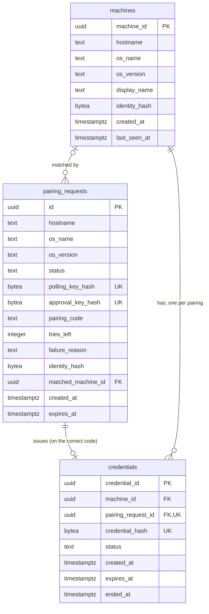
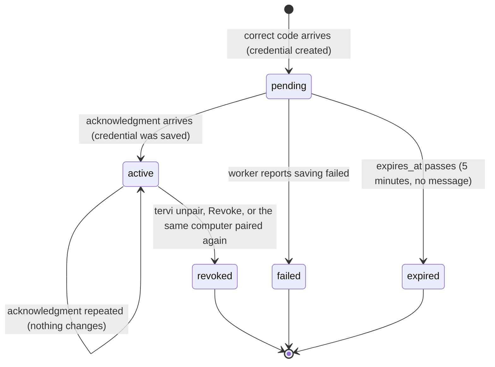

# Data model

Everything tervi stores: the server's database tables and the worker's local
data. This file lives across slices; each slice's plan pull request updates
it. The HTTP contract is in [`api/openapi.yaml`](../api/openapi.yaml).

**Source of truth.** For the database, the migration files in
`internal/server/db/migrations/` are the truth; this file explains them and
must agree with them. For the worker's local data, this file is the truth.

## Server database



A machine is one computer. Each pairing that reaches the correct code issues
one credential for a machine: a new machine, or the earlier machine it
matched. A pairing request issues at most one credential, and a credential
always belongs to exactly one pairing request and one machine. Slice 0003
moved the credential out of `machines` (migration `0003`), so a machine
keeps one row across pairings.

### `pairing_requests`

One row per pairing attempt. Added by slice 0001 (migration `0001`).

| Column | Type | Rules | Meaning |
| --- | --- | --- | --- |
| `id` | `uuid` | primary key, generated | The pairing request's ID |
| `hostname` | `text` | not null, default `''` | As reported by the worker; may be empty; at most 64 characters (checked by the API) |
| `os_name` | `text` | not null, default `''` | As reported by the worker; may be empty; at most 64 characters |
| `os_version` | `text` | not null, default `''` | As reported by the worker; may be empty; at most 32 characters |
| `status` | `text` | not null, one of the lifecycle states below | Where the attempt is |
| `polling_key_hash` | `bytea` | not null, unique | SHA-256 of the polling key; the key itself is never stored |
| `approval_key_hash` | `bytea` | not null, unique | SHA-256 of the approval key; the key itself is never stored |
| `pairing_code` | `text` | null until Accept | The 8-digit code, stored as shown, for example `1234-5678`, so the page can show it again |
| `tries_left` | `integer` | not null, default `5` | Wrong codes still allowed |
| `failure_reason` | `text` | null, or `wrong_codes`, `not_saved`, `not_confirmed` | Set whenever the status becomes `failed` |
| `identity_hash` | `bytea` | null, 32 bytes when set | The computer's identity as sent by the worker; null when it sent none. Added by slice 0003 (migration `0003`). |
| `matched_machine_id` | `uuid` | null, references `machines(machine_id)` | The earlier machine this computer was recognized as, decided once when the pairing started; null when none matched. Added by slice 0003. |
| `created_at` | `timestamptz` | not null, default `now()` | When the worker started |
| `expires_at` | `timestamptz` | not null | 10 minutes after creation; covers only the human steps |

#### Lifecycle

Boxes are the values of `status`. A state with no arrow out is final.


**Expiry is applied when read.** A row past `expires_at` may still say
`waiting_for_…` in the table; every query reads it as `expired` (and a
`finishing` row whose credential expired as `failed`). A clean-up job runs
every minute and writes those states into the table.

### `machines`

One row per computer. Added by slice 0001 (migration `0001`); since slice
0003 it holds no credential. Created when the correct code arrives for a
pairing that matched no earlier machine.

| Column | Type | Rules | Meaning |
| --- | --- | --- | --- |
| `machine_id` | `uuid` | primary key, generated | The machine's permanent ID |
| `hostname` | `text` | not null, default `''` | From the pairing request; updated from each later pairing when it is acknowledged |
| `os_name` | `text` | not null, default `''` | As `hostname` |
| `os_version` | `text` | not null, default `''` | As `hostname` |
| `display_name` | `text` | not null | The hostname, or `unknown` when that is empty; updated with `hostname` |
| `identity_hash` | `bytea` | null, 32 bytes when set; indexed, not unique | The computer's identity, from the pairing that created the machine; null for a machine created before slice 0003 or paired without a machine ID, and a null never matches. Not unique: copied virtual machines can share one. Added by slice 0003. |
| `created_at` | `timestamptz` | not null, default `now()` | When the correct code of its first pairing arrived |
| `last_seen_at` | `timestamptz` | null until the first connection | When the server last heard from the machine over its connection. Added by slice 0002 (migration `0002`). |

**`last_seen_at`** is set when the machine connects, at least once a minute
while it stays connected, and when the connection ends (the time of the last
message received). If the server stops suddenly, or the machine had stopped
answering when the server stopped (the server waits at most 5 seconds in
all), it may be up to one minute early. Whether a machine is Online is not
stored: it is true exactly while the server holds the machine's connection
in memory.

**Paired** is not stored either: a machine is paired exactly while it has an
`active` credential. Only paired machines appear anywhere the user can see,
except the approval page's match (below). A machine whose credentials all
ended stays in the table, for its history and so the same computer can be
recognized.

**Matching.** When a pairing starts with an identity, the server looks for
machines with the same `identity_hash` that have had an `active` or
`revoked` credential, and takes the one whose latest `active` or `revoked`
credential was created last (a `failed` or `expired` attempt does not
count); that machine becomes the request's `matched_machine_id`.

### `credentials`

One row per credential issued: one per pairing that reached the correct
code. Added by slice 0003 (migration `0003`), which moved each existing
machine's credential here.

| Column | Type | Rules | Meaning |
| --- | --- | --- | --- |
| `credential_id` | `uuid` | primary key, generated | The credential row's ID |
| `machine_id` | `uuid` | not null, references `machines(machine_id)` | The machine this credential proves |
| `pairing_request_id` | `uuid` | not null, unique, references `pairing_requests(id)` | The pairing that issued it |
| `credential_hash` | `bytea` | not null, unique | SHA-256 of the credential; the credential itself is never stored |
| `status` | `text` | not null, one of the lifecycle states below | Where the credential is |
| `created_at` | `timestamptz` | not null, default `now()` | When the correct code arrived |
| `expires_at` | `timestamptz` | not null | 5 minutes after creation; matters only while `pending` |
| `ended_at` | `timestamptz` | null until `revoked` | When it was revoked; the approval page shows it as "unpaired on <date>" |

At most one credential per machine is `active` (a unique index on
`machine_id` for `active` rows).

#### Lifecycle



Each change out of `pending` also moves its pairing request out of
`finishing`: acknowledged → `paired`; saving failed → `failed`
(`not_saved`); expired → `failed` (`not_confirmed`). Both change in one
transaction. When the acknowledged pairing matched an earlier machine, the
same transaction revokes that machine's earlier `active` credential and
updates the machine's hostname, OS, and display name.

`revoked` covers every way a credential stops working: `tervi unpair` on
the computer, Revoke on the Machines page, and pairing the same computer
again. The server records only that it ended and when.

A `pending` credential is accepted for nothing except acknowledging or
reporting a failure. A `revoked` one is refused with `credential_revoked`,
and a `failed` or `expired` one, like an unknown one, with
`unknown_credential`.

## Worker local data

The worker keeps four things on the paired computer: `credential.json`,
`state.json`, the systemd service file, and the runtime folder.
Later worker versions
must still read the first two, so changing their format needs a migration
plan of its own. `tervi unpair` removes the first three (slice 0003); the
runtime folder goes away by itself when the user's service manager stops.
The worker also reads `/etc/machine-id` when it pairs, to compute the
computer's identity (slice 0003), but saves nothing from it.

Until slice 0002's fix 4, the credential was kept in the OS secret store
(GNOME Keyring, service `tervi`, user `worker`) with the same JSON. There is
no migration: a computer paired that way has `state.json` but no
`credential.json`, so `tervi pair` reports the incomplete pairing data,
removes `state.json`, and starts a new pairing. The old keyring entry is
left as it was.

### `credential.json`

`~/.config/tervi/credential.json`, next to `state.json`. Mode `0600`: only
the user's own account can read or write it; the folder is `0700`. Written
once, at pairing, to a temporary file in the same folder that is then
renamed over the old one. The worker refuses a file with any group or other
permission, or owned by another account, and never changes its permissions
itself (slice 0002, R36). Before a new pairing, `tervi pair` checks that it
can store a file there by writing, reading, and removing
`credential-check.json` in the same folder; it holds a fixed test value,
nothing secret, and a crash at that moment can leave it behind harmlessly.
A crash in the middle of writing `credential.json` can leave its temporary
file (`.credential-` and a random suffix) in the same folder; it holds the
credential but has mode `0600` too; tervi never reads it, and it can be
deleted. `tervi unpair` deletes `credential.json`, then these leftovers and
`credential-check.json`, so no copy of the secret remains (slice 0003).
Its content is JSON:

```json
{ "server": "http://localhost:8080", "credential": "<credential>" }
```

| Field | Meaning |
| --- | --- |
| `server` | The server that issued the credential, in standard form. **The only place the worker reads the server address from before sending the credential.** |
| `credential` | The machine credential. Secret. |

### `state.json`

`~/.config/tervi/state.json` (the user's configuration folder). Holds nothing
secret and no server address, so editing it cannot redirect the credential.

```json
{
  "machine_id": "…",
  "credential_saved": true,
  "confirmed": true,
  "connect": true,
  "stop_reason": null
}
```

| Field | Meaning |
| --- | --- |
| `machine_id` | The machine this computer became |
| `credential_saved` | `false` from just before `credential.json` is saved; `true` once it was saved and read back |
| `confirmed` | `true` once the server answered OK to the acknowledgment |
| `connect` | Whether this computer wants to be connected. A missing field (a computer paired in slice 0001) means `false`. `false` with `stop_reason: null` means the user disconnected (slice 0003). Added by slice 0002. |
| `stop_reason` | Why the daemon stopped trying to connect: `null`; `"credential_rejected"` (the server answered `unknown_credential`); or `"credential_revoked"` (the server closed with `4002` or answered `credential_revoked`; added by slice 0003). Later slices may add values. Added by slice 0002. |

**Who writes which fields.** `tervi pair` writes `machine_id`,
`credential_saved`, and `confirmed`, and carries `connect` and
`stop_reason` over unchanged from the record it read (`false` and `null` for
a new pairing, which starts with no `state.json`). Only the program holding
`daemon.lock` changes `connect` and `stop_reason` (slice 0003; before it,
only the daemon). A running daemon holds the lock, so `tervi pair`,
`tervi connect`, and `tervi disconnect` ask it; `tervi pair` and
`tervi connect` start it first if it is not running, while
`tervi disconnect` takes the lock itself and writes `connect: false`.

The first write, `credential_saved: false`, comes **before**
`credential.json` is saved, so a stop at any moment leaves a note saying
what was about to happen. The later writes record what finished:
`credential_saved: true` after the file was saved and read back,
`confirmed: true` after the server's OK.

### systemd service file

`~/.config/systemd/user/tervi.service`, the folder for services a user sets
up. Written by `tervi pair` and `tervi connect` when it is missing or its
`ExecStart` names another program path (slice 0002). Holds nothing secret.

```ini
[Unit]
Description=tervi worker

[Service]
ExecStart="<full path of the installed tervi>" daemon
Restart=on-failure
RestartSec=5

[Install]
WantedBy=default.target
```

| Line | Meaning |
| --- | --- |
| `ExecStart` | The full path of the `tervi` program that wrote the file, so systemd finds it without the user's `PATH`. The path is in double quotes, so a path with a space stays one word; inside the quotes, `\` and `"` are written `\\` and `\"`, and systemd's special characters `%` and `$` are written `%%` and `$$` |
| `Restart=on-failure`, `RestartSec=5` | Started again 5 seconds after it stops unexpectedly; a clean stop stays stopped |
| `WantedBy=default.target` | Started whenever the user's service manager starts, once enabled: at boot, because pairing turns on linger (`loginctl enable-linger`, slice 0002 fix 4), and it keeps running when no one is logged in |

### Runtime folder

`$XDG_RUNTIME_DIR/tervi/` (usually `/run/user/<user id>/tervi/`), mode
`0700`, created by the daemon (slice 0002). Linux keeps it in memory; with
linger on, it exists from boot and stays while the user's service manager
runs. Holds nothing secret.

| File | Mode | Meaning |
| --- | --- | --- |
| `daemon.lock` | `0600` | Held with an exclusive `flock` by the one running daemon, or for a moment by `tervi disconnect` or `tervi unpair` when no daemon runs (slice 0003); Linux releases it when its holder ends |
| `daemon.sock` | `0600` | The Unix socket the `tervi` commands use to reach the daemon. Removed by the daemon when it stops; a new daemon replaces one left by a crash |

## Names

| Name | What it is |
| --- | --- |
| Pairing request | The record of one pairing attempt |
| Approval key | The random key in the approval link `/pair/<approval key>` |
| Polling key | The worker's own key; it polls and submits the code with it |
| Pairing code | The code the browser shows and the user types into the terminal |
| Credential | The permanent proof the worker receives at the end |
| Machine | A paired computer, as the server records it |
